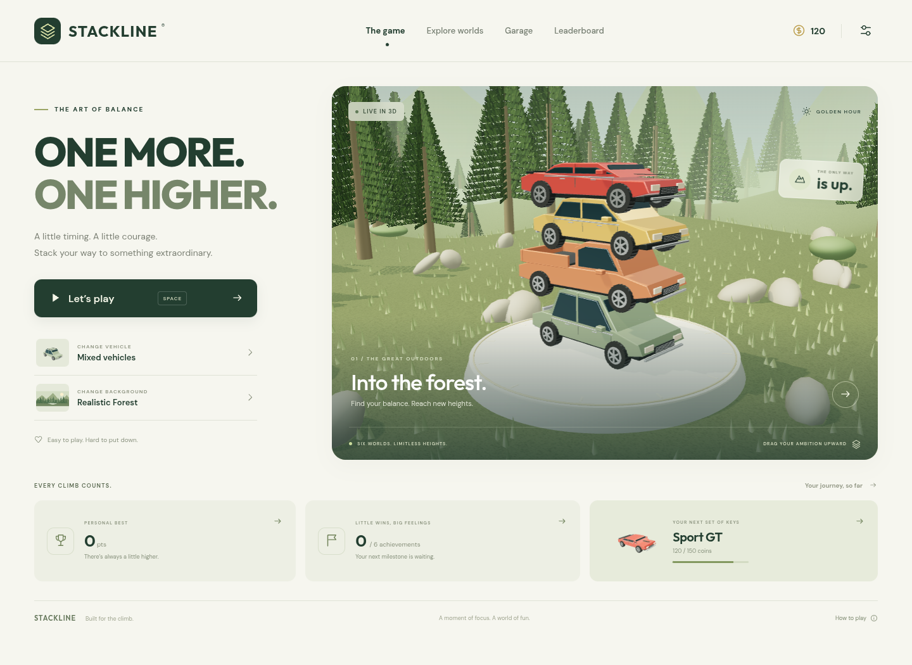

# Stackline

A complete, touch-friendly 3D vehicle stacking game built with Three.js, Cannon ES, TypeScript, and Capacitor. The home screen, garage, environments, progression, and gameplay work without an account or remote assets.



## Play and develop

Requires Node.js 22.12+ (this environment uses Node 24) and a WebGL-capable browser.

```bash
npm ci
npm run dev
```

Tap **Let’s play**, or press **Space**. A vehicle sweeps above the tower: tap the scene, click **Drop vehicle**, or press **Space** to release it. Centered landings earn perfect bonuses, coins, and consecutive multipliers, capped at 5×. Off-center vehicles can tip or topple the tower. **Escape** pauses the game. Changing tabs pauses automatically.

```bash
npm run build       # strict TypeScript validation and production bundle
npm test            # progression, purchases, persistence, reward rules
npm run test:e2e    # builds, then tests live 3D gameplay with Chromium
npm run preview     # serve the production bundle
```

The browser tests use `/usr/bin/chromium` by default. Set `CHROMIUM_PATH` to a locally installed Chromium binary elsewhere. They use software WebGL, exercise real inputs and rigid-body simulation, and never replace physics or scores with mocked state.

## Included

- Six vehicle types: classic coupe, SUV, pickup, sports car, city bus, tractor. Each has original generated 3D bodywork, glass, lighting details, trim, tires, and rims. Models are batched by material to reduce draw calls.
- Fixed-vehicle selection and mixed mode, which draws only from unlocked vehicles.
- Forest, night city, space, snow mountains, desert, and beach worlds, built from 3D geometry. Clouds move, beach water animates, and the camera climbs with the physical tower.
- Gravity, compound rigid-body collision shapes, friction, impact settling, stability monitoring, slow-motion perfect landings, camera shake, and collision particles.
- Synthesized sound effects, optional vibration, and reduced-motion settings.
- Earned coins, three unlockable vehicles, six achievements, high scores, and local leaderboards. A new save receives 120 starter coins.
- Saved choices, settings, purchases, achievements, scores, and coins in versioned local storage. Invalid or unavailable storage does not prevent play.
- Responsive desktop and mobile UI, keyboard controls, accessible native dialogs, self-hosted fonts, and adaptive rendering quality.
- Android application project with a branded launcher/splash, hardware-accelerated WebView, portrait orientation, and bundled offline assets.

## Android

The native project uses application ID `com.trishool.stackline`, Capacitor 7, Java 21, and Android API 35. All game assets are packaged locally; gameplay does not depend on CDN access.

```bash
npm run android:sync
npm run android:open
```

Build in Android Studio, or with an installed SDK:

```bash
cd android
./gradlew assembleDebug
./gradlew bundleRelease
```

In this cloud environment, `scripts/setup-java.sh` installs checksum-verified Temurin JDK 21, and `scripts/setup-android.sh` installs checksum-verified Google command-line tools and the required SDK into `/workspace/.android-sdk`. It accepts SDK licenses for the installed toolchain. The cloud build helper configures Java proxy routing and a local truststore containing the platform CA; TLS and distribution checksum verification remain enabled. Build with:

```bash
bash scripts/setup-java.sh
bash scripts/setup-android.sh
export ANDROID_HOME=/workspace/.android-sdk
export ANDROID_SDK_ROOT="$ANDROID_HOME"
export ANDROID_USER_HOME=/workspace/.android-user-home
export GRADLE_USER_HOME=/workspace/.stackline-cache/gradle
npm run android:sync
python3 scripts/build-android-cloud.py assembleDebug
```

## Architecture

- `src/game.ts`: renderer, camera, physical tower, input-facing gameplay API, timing, landing detection, effects.
- `src/vehicles.ts`: detailed procedural vehicle meshes and material-batched model cache.
- `src/scenery.ts`: environment geometry, foliage and ground textures, lighting, atmospheric animation.
- `src/main.ts` / `src/style.css`: responsive menus, HUD, dialogs, achievements, and progression integration.
- `src/store.mjs`: versioned saves, vehicle costs, achievement definitions, reward rules, personal rankings.
- `src/audio.ts`: Web Audio synthesis triggered after player interaction.
- `tests/`: unit coverage plus live browser integration checks.

## Release work still required

The vehicle meshes and environments are original procedural art with PBR materials; they are not scanned or licensed photorealistic production assets. Collision hulls approximate the vehicle shapes to keep stacking responsive. A production realism pass can replace this art with professionally authored, optimized models and textures while retaining the game systems.

Rankings are local to the device. Global authenticated leaderboards, cloud saves, and anti-cheat require a backend and are not simulated here. No ads, analytics, real-money transactions, or external tracking are included.

Before Google Play release, choose the final package identity, create a private signing key, configure release signing, review current target API requirements, prepare the privacy/Data Safety declarations and store artwork, and validate frame times, memory, audio, vibration, pause/resume, and WebView compatibility on physical Android devices. The cloud browser checks do not establish device performance or store readiness. Never commit signing keys or credentials.

Bundled license texts are included in `public/THIRD_PARTY_NOTICES.txt` and in the Android/web assets. Fonts are distributed through the Fontsource packages under their bundled font licenses. Three.js and Cannon ES use the MIT license; Capacitor uses MIT. Game meshes, textures, interface art, and sound synthesis are created in source and need no remote asset download.
