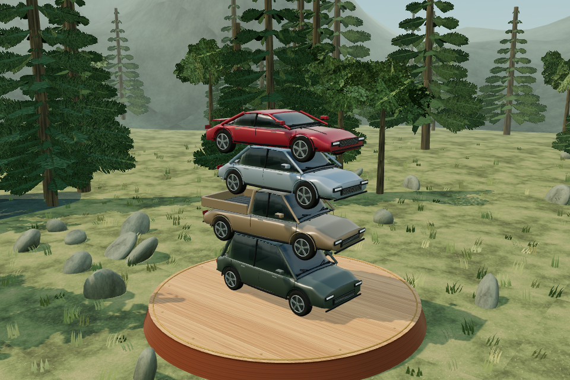
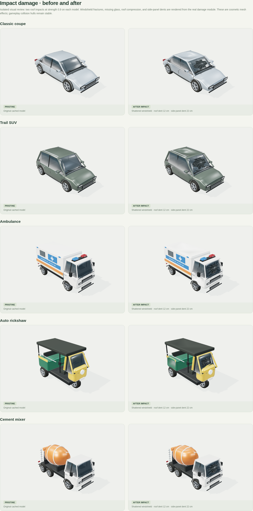
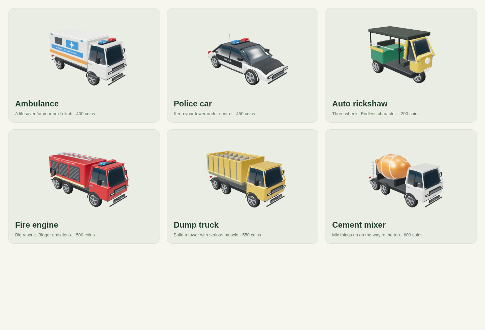

# Stack Vechiles

A complete, touch-friendly 3D vehicle stacking game built with Three.js, Cannon ES, TypeScript, and Capacitor. The home screen, garage, environments, progression, and gameplay work without an account or remote assets.



## Play and develop

Requires Node.js 22.12+ (this environment uses Node 24) and a WebGL-capable browser.

```bash
npm ci
npm run dev
```

Tap **Let’s play**, or press **Space**. A vehicle sweeps above the tower: tap the scene, click **Drop vehicle**, or press **Space** to release it. Centered landings earn perfect bonuses, coins, and consecutive multipliers, capped at 5×. Off-center vehicles can tip or topple the tower. **Escape** pauses the game. Changing tabs pauses automatically.

The fixed starting vehicle supports the tower on its platform. Any dropped or stacked vehicle touching the platform or the surrounding ground immediately ends the run, including contact by a wheel. A vehicle that slides down later is still monitored.

The phone home screen keeps the live 3D preview, **Let’s play**, **Change vehicle**, and **Change place** on one fixed screen. Swipe vertically inside **Change vehicle**, **Change place**, or **Garage** to see every choice; their headings and footer buttons stay in place. Selecting a vehicle or place preserves your position in the list. Tap **Done** at the bottom to save and, if needed, purchase the selected choice. The **Cancel** button closes the dialog and discards the pending selection without spending coins. Achievements scroll vertically inside their dialog, with the heading fixed. The leaderboard uses **Previous** and **Next**, with page sizes that adapt to screen height and orientation.

The upbeat 126 BPM arcade soundtrack is on by default. Its bundled audio is loaded and decoded before Play is enabled, so the Play gesture schedules music immediately without composing it during gameplay. It combines drums, bass, and a bright melody, with normalized loudness for phone speakers and bounded peaks. It pauses with the game and fades out on game over or return home. In **Settings → Background music**, you can turn it off independently of sound effects; your preference is saved for future sessions.

The rendering system caps the home preview at 30 FPS and gameplay rendering at 60 FPS, stops rendering behind menus and while inactive, and batches repeated scenery. These are frame budgets; actual FPS depends on the device. Auto graphics adapts to sustained gameplay load, while High and Battery saver remain explicit choices. See [performance measurements and the Pixel 8 test checklist](docs/PERFORMANCE.md).

```bash
npm run build       # strict TypeScript validation and production bundle
npm test            # progression, persistence, surface contacts, impact audio
npm run test:e2e    # builds, then tests live 3D gameplay with Chromium
npm run preview     # serve the production bundle
```

The browser tests use `/usr/bin/chromium` by default. Set `CHROMIUM_PATH` to a locally installed Chromium binary elsewhere. They use software WebGL, exercise real inputs and rigid-body simulation, and never replace physics or scores with mocked state.

## Natural lighting and impact damage — 1.5.0

All 12 vehicles now use finer paint roughness, reflective laminated glazing, detailed light lenses, glazing seals and wipers, and subdued cabin details. Reflections match the selected world through original environment panoramas instead of a fixed studio-light environment. Paint and trim keep their material batches and shared undamaged geometry.

Vehicle contacts produce **windshield cracks, broken-out glass, roof dents, and door dents/scuffs**. Repeated or stronger impacts increase the visible damage, with short-lived glass chips at the impact. Both the arriving vehicle and the supporting vehicle can be marked. Damage belongs to the individual vehicle instance, so another copy of the same car stays pristine until it is hit; replay/home clear the damaged run.

Damage changes the rendered panels. The rigid collision hulls, supporting roof rails, stacking rewards, and ground-contact loss rule retain their established behavior. This is bounded cosmetic deformation rather than a soft-body crash simulation; doors are dented, not detached. Glass chips share a bounded instance pool.

The environments also have a new pass: 3D radial pine branches, alpha-textured broadleaf foliage clusters, blade grass, bark/soil/rock surface variation, continuous eroded mountain ridges, atmospheric sky gradients and soft clouds. Night City has lit facade textures, setbacks and warmer streetlights. Beach has curved palm trunks, feathered fronds, normal-mapped water and shoreline foam. Snow, sand dunes, and the planets/moon in Space use their own procedural surface detail.

All visual assets remain original, procedural and bundled for offline play. They are not photographic scans. Auto/High/Battery saver and the 30/60 FPS rendering budgets remain available; empirical Pixel 8 frame rates, warmth and battery use still need device testing. Current validation is recorded in [VALIDATION.md](docs/VALIDATION.md).



## Expanded vehicle fleet — 1.4.0

Six new original 3D models join the game: **Ambulance, Police car, Auto rickshaw, Fire engine, Dump truck, and Cement mixer**. That makes **12 vehicles plus Mixed mode**. Emergency vehicles have light bars and markings; the rickshaw has three wheels and an open cabin; the fire engine carries a ladder and equipment bays; the dump truck has a loaded bed; and the mixer has a shaped drum, chute, and access ladder.

| New vehicle | Unlock cost |
| --- | ---: |
| Auto rickshaw | 200 coins |
| Ambulance | 400 coins |
| Police car | 450 coins |
| Fire engine | 500 coins |
| Dump truck | 550 coins |
| Cement mixer | 600 coins |

The first three vehicles remain free. Existing coins, purchases, choices, and records are preserved. New unlocks join the random pool in Mixed mode, or choose one vehicle and tap Done to use it alone. Cancel discards the pending choice. The picker and Garage scroll through all 13 cards with their action buttons fixed. Collision-driven crash sounds also apply to the new fleet. New collector achievements require every vehicle; previously earned achievements are retained.



## AdMob test interstitials — 1.3.0

The native Android app preloads a Google test interstitial and presents it after every third completed game, before the results screen. Pausing, restarting, or returning home before losing does not count. The counter survives reopening; Reset game clears it. If no ad is ready, that break is skipped without waiting or showing it later during play. Music/effects stay silent during the ad, and replay controls return only after dismissal or a presentation failure.

This ZIP uses Google’s demo AdMob application and interstitial IDs, with test mode enabled. It serves no revenue ads and needs no personal AdMob IDs for testing. **Browser play (`npm run dev`, Chrome, or a home-screen web shortcut) does not display native AdMob ads.** See [Android ad testing](docs/ADMOB.md) for installation and the three-game check.

## Play, progression, and selection

- **Free:** Mixed mode, Classic coupe, Trail SUV, Pickup truck; Realistic Forest, Night City, Outer Space.
- **150 coins:** Sport GT or Snow Mountains. **250 coins:** City bus or Desert. **350 coins:** Field tractor or Beach. Each is a separate permanent unlock using earned in-game coins.
- Vehicle/place selectors have **Cancel** on the left and **Done** on the right, separated by 10px. The × header icon is removed on these screens. **Done** confirms the pending vehicle/place selection and purchases it once if locked. Using **Cancel**, Escape, or Back cancels without spending coins. Purchases and choices persist after reopening.
- **Settings → Reset game** opens a confirmation alert. Confirming clears coins, purchases, records, achievements, selections, and settings, returns home with only the free choices, and saves the fresh state. Cancelling leaves the save intact. Other apps' browser storage is untouched.
- Existing balances and purchased vehicles are preserved. Old saves without place ownership start with the three free places; a formerly selected paid place changes to Forest until unlocked.
- The original soundtrack is preloaded; its playback source starts in the Play handler. Crash buffers are also prepared before gameplay. A first crash can be scheduled while Android's audio context resumes, instead of being discarded while suspended.

To change the original score, edit `src/music-score.ts` and run `node scripts/render-audio.mjs` with Chromium and ffmpeg installed. The checked-in `public/audio/arcade-loop.ogg` is used during normal development and Android builds; these authoring tools are optional for players and developers using the existing score.

## Vehicle and impact update — 1.1.0

The original six vehicles received curved body shells, shaped wheel arches, reflective tinted glass, metallic clearcoat paint, panel seams, mirrors, tire tread, brake discs, and detailed alloy rims. The pickup has an open bed; the SUV has roof rails; the sports car has a rear spoiler; the bus has individual glazing and doors; the tractor has chunky agricultural tires and cab steps. These are original generated models, shared and batched into 8–9 draw calls per vehicle, with approximately 16,500–18,500 triangles each.


Collisions now play an original layered chassis thud, metal crunch, panel resonance, and loose rattle at the actual physics contact. Harder impacts play louder and deeper. Low-speed resting contacts and duplicate collision events stay quiet. Music briefly ducks under a crash; **Settings → Sound effects** still controls impacts independently of background music and saves the preference.

## Included

- Twelve vehicle types: classic coupe, SUV, pickup, sports car, city bus, tractor, ambulance, police car, auto rickshaw, fire engine, dump truck, cement mixer. Each has original generated 3D bodywork, glass, lighting details, trim, tires, and rims. Models are batched by material to reduce draw calls.
- Fixed-vehicle selection and mixed mode, which draws only from unlocked vehicles.
- Forest, night city, space, snow mountains, desert, and beach worlds, with original procedural surface textures, atmospheric skies and world-matched reflections. Clouds move, beach water animates, and the camera climbs with the physical tower.
- Gravity, compound rigid-body collision shapes, friction, impact settling, stability monitoring, slow-motion perfect landings, camera shake, and collision particles. Individual vehicles show cosmetic windshield breakage, roof/door dents, scuffs and short-lived glass fragments.
- Synthesized sound effects, an original looping background score with independent music and effects controls, optional vibration, and reduced-motion settings. The score is bundled as an original Ogg track, decoded before Play and reused without composing or scheduling individual notes during gameplay.
- Earned coins, nine unlockable vehicles and three unlockable places, six achievements, high scores, and local leaderboards. A new or reset save starts with zero coins. Normal landings earn **1 coin**; perfect landings earn **3 coins**, regardless of combo. Combos multiply points only.
- Saved choices, settings, purchases, achievements, scores, and coins in versioned local storage. Invalid or unavailable storage does not prevent play.
- A polished wooden platform with plank grain, a warm rim, and fine brass trim in every world.
- Fixed viewport desktop and mobile UI with large touch controls, vertically scrolling vehicle/place lists, keyboard controls, accessible native dialogs, self-hosted fonts, and adaptive rendering quality.
- Android application project with a picture launcher/splash adapted from the supplied stacked-vehicles image, hardware-accelerated WebView, portrait orientation, and bundled offline assets. The same picture appears in the home logo, browser icon, and home-screen shortcut.

## Android

The native project uses application ID `com.trishool.stackline`, version **1.5.0 / code 8**, Capacitor 7, Java 21, and Android API 35. All game assets are packaged locally; gameplay does not depend on CDN access.

A prebuilt **unsigned release AAB** and local signing instructions are included in [releases/README.md](releases/README.md). Run `node scripts/sign-aab.mjs` to sign it on your PC using an existing upload key or a newly created key. Private keys stay on your PC. Check Play Console's current target API requirement before submission.

```bash
npm run android:sync
npm run android:open
```

Build in Android Studio, or with an installed SDK:

```bash
cd android
./gradlew assembleDebug
./gradlew bundleRelease
```

In this cloud environment, `scripts/setup-java.sh` installs checksum-verified Temurin JDK 21, and `scripts/setup-android.sh` installs checksum-verified Google command-line tools and the required SDK into `/workspace/.android-sdk`. It accepts SDK licenses for the installed toolchain. The cloud build helper configures Java proxy routing and a local truststore containing the platform CA; TLS and distribution checksum verification remain enabled. Build with:

```bash
bash scripts/setup-java.sh
bash scripts/setup-android.sh
export ANDROID_HOME=/workspace/.android-sdk
export ANDROID_SDK_ROOT="$ANDROID_HOME"
export ANDROID_USER_HOME=/workspace/.android-user-home
export GRADLE_USER_HOME=/workspace/.stackline-cache/gradle
npm run android:sync
python3 scripts/build-android-cloud.py assembleDebug
```

The master app icon is `public/icons/icon-512.png`. To regenerate its browser, Apple touch, and Android density variants after replacing it, run `bash scripts/generate-icons.sh` with ImageMagick 7 installed, then sync Android again.

## Architecture

- `src/game.ts`: renderer, camera, physical tower, input-facing gameplay API, timing, landing detection, effects.
- `src/physics.mjs`: platform and ground collision monitoring for every dynamic vehicle, including previously stacked vehicles.
- `src/vehicles.ts`: detailed procedural vehicle meshes and material-batched model cache.
- `src/vehicle-specs.mjs` / `src/vehicle-physics.mjs`: dimensions, masses, and shared gameplay collision bodies, including three-wheel and three-axle layouts.
- `src/scenery.ts`: environment geometry, 3D foliage, terrain materials, skies, clouds, water and atmospheric animation.
- `src/world-lighting.ts`: generated environment panoramas and world-matched PBR reflections.
- `src/vehicle-damage.ts` / `src/damage-rules.mjs`: per-instance cosmetic deformation, glazing cracks/breakage, scuffs, bounded glass fragments, contact filtering and coordinate conversion.
- `src/main.ts` / `src/style.css` / `src/layout.css`: menus, HUD, fixed viewport layouts, scrollable selection dialogs, achievements, and progression integration.
- `src/store.mjs`: versioned saves, vehicle costs, achievement definitions, reward rules, personal rankings.
- `src/impacts.mjs`: collision strength/cooldown rules and original crash waveform synthesis.
- `src/admob.ts` / `src/interstitials.ts`: native test-ad adapter, persistent three-game frequency, cache expiry, and dismissal gating.
- `src/audio.ts`: preloaded background music, collision-driven effects, and independent controls with pause/resume handling.
- `src/music-score.ts` / `scripts/render-audio.mjs`: original score composition and optional authoring pipeline for the bundled Ogg track.
- `tests/`: unit coverage plus live browser integration checks.

## Release work still required

The vehicle meshes, surface textures and environments are original procedural art with PBR materials; they are not scanned photographic assets. Collision hulls approximate the vehicle shapes to keep stacking responsive. Impact damage is cosmetic and retains those rigid hulls; full soft-body deformation and detached-door physics are not implemented.

Rankings are local to the device. Global authenticated leaderboards, cloud saves, and anti-cheat require a backend and are not simulated here. Native Android includes Google Mobile Ads for test interstitials; its SDK makes network requests. Browser play has no ads. No analytics service or real-money transactions are implemented. Live monetization is not enabled in this test build.

Before Google Play release, choose the final package identity, create a private signing key, configure release signing, review current target API requirements, prepare the privacy/Data Safety declarations and store artwork, and validate frame times, memory, audio, vibration, pause/resume, and WebView compatibility on physical Android devices. The cloud browser checks do not establish device performance or store readiness. Never commit signing keys or credentials.

Bundled license texts are included in `public/THIRD_PARTY_NOTICES.txt` and in the Android/web assets. Fonts are distributed through the Fontsource packages under their bundled font licenses. Three.js and Cannon ES use the MIT license; Capacitor uses MIT. Game meshes, procedural textures, and sound synthesis are created in source. The picture icon is adapted from the supplied stacked-vehicles image and bundled locally; no game asset needs a remote download at runtime.
