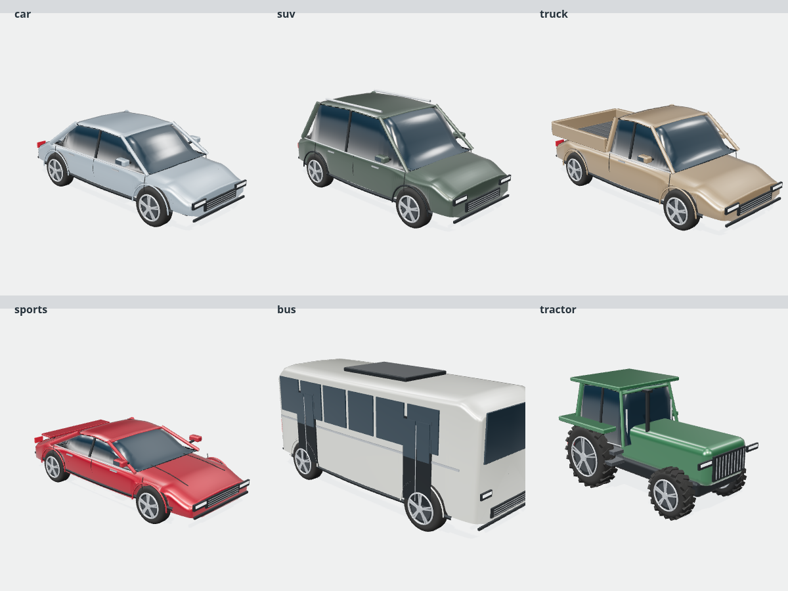

# Stack Vechiles

A complete, touch-friendly 3D vehicle stacking game built with Three.js, Cannon ES, TypeScript, and Capacitor. The home screen, garage, environments, progression, and gameplay work without an account or remote assets.


## Play and develop

Requires Node.js 22.12+ (this environment uses Node 24) and a WebGL-capable browser.

```bash
npm ci
npm run dev
```

Tap **Let’s play**, or press **Space**. A vehicle sweeps above the tower: tap the scene, click **Drop vehicle**, or press **Space** to release it. Centered landings earn perfect bonuses, coins, and consecutive multipliers, capped at 5×. Off-center vehicles can tip or topple the tower. **Escape** pauses the game. Changing tabs pauses automatically.

The fixed starting vehicle supports the tower on its platform. Any dropped or stacked vehicle touching the platform or the surrounding ground immediately ends the run, including contact by a wheel. A vehicle that slides down later is still monitored.

The phone home screen keeps the live 3D preview, **Let’s play**, **Change vehicle**, and **Change place** on one fixed screen. Swipe vertically inside **Change vehicle**, **Change place**, or **Garage** to see every choice; their headings and close buttons stay in place. Selecting a vehicle or place preserves your position in the list. Achievements and the leaderboard use **Previous** and **Next**, with page sizes that adapt to screen height and orientation.

The upbeat 126 BPM arcade soundtrack is on by default and starts when you choose **Let’s play**. It combines drums, bass, and a bright melody, with normalized loudness for phone speakers and bounded peaks. It pauses with the game and fades out on game over or return home. In **Settings → Background music**, you can turn it off independently of sound effects; your preference is saved for future sessions.

The rendering system caps the home preview at 30 FPS and gameplay rendering at 60 FPS, stops rendering behind menus and while inactive, and batches repeated scenery. These are frame budgets; actual FPS depends on the device. Auto graphics adapts to sustained gameplay load, while High and Battery saver remain explicit choices. See [performance measurements and the Pixel 8 test checklist](docs/PERFORMANCE.md).

```bash
npm run build       # strict TypeScript validation and production bundle
npm test            # progression, persistence, surface contacts, impact audio
npm run test:e2e    # builds, then tests live 3D gameplay with Chromium
npm run preview     # serve the production bundle
```

The browser tests use `/usr/bin/chromium` by default. Set `CHROMIUM_PATH` to a locally installed Chromium binary elsewhere. They use software WebGL, exercise real inputs and rigid-body simulation, and never replace physics or scores with mocked state.

## Vehicle and impact update — 1.1.0

All six vehicles now have curved body shells, shaped wheel arches, reflective tinted glass, metallic clearcoat paint, panel seams, mirrors, tire tread, brake discs, and detailed alloy rims. The pickup has an open bed; the SUV has roof rails; the sports car has a rear spoiler; the bus has individual glazing and doors; the tractor has chunky agricultural tires and cab steps. These are original generated models, shared and batched into 8–9 draw calls per vehicle, with approximately 16,500–18,500 triangles each.



Collisions now play an original layered chassis thud, metal crunch, panel resonance, and loose rattle at the actual physics contact. Harder impacts play louder and deeper. Low-speed resting contacts and duplicate collision events stay quiet. Music briefly ducks under a crash; **Settings → Sound effects** still controls impacts independently of background music and saves the preference.

## Included

- Six vehicle types: classic coupe, SUV, pickup, sports car, city bus, tractor. Each has original generated 3D bodywork, glass, lighting details, trim, tires, and rims. Models are batched by material to reduce draw calls.
- Fixed-vehicle selection and mixed mode, which draws only from unlocked vehicles.
- Forest, night city, space, snow mountains, desert, and beach worlds, built from 3D geometry. Clouds move, beach water animates, and the camera climbs with the physical tower.
- Gravity, compound rigid-body collision shapes, friction, impact settling, stability monitoring, slow-motion perfect landings, camera shake, and collision particles.
- Synthesized sound effects, an original looping background score with independent music and effects controls, optional vibration, and reduced-motion settings. The score is rendered once into a reusable audio buffer to avoid ongoing music scheduling on the game thread.
- Earned coins, three unlockable vehicles, six achievements, high scores, and local leaderboards. A new save receives 120 starter coins.
- Saved choices, settings, purchases, achievements, scores, and coins in versioned local storage. Invalid or unavailable storage does not prevent play.
- A polished wooden platform with plank grain, a warm rim, and fine brass trim in every world.
- Fixed viewport desktop and mobile UI with large touch controls, vertically scrolling vehicle/place lists, keyboard controls, accessible native dialogs, self-hosted fonts, and adaptive rendering quality.
- Android application project with a picture launcher/splash adapted from the supplied stacked-vehicles image, hardware-accelerated WebView, portrait orientation, and bundled offline assets. The same picture appears in the home logo, browser icon, and home-screen shortcut.

## Android

The native project uses application ID `com.trishool.stackline`, Capacitor 7, Java 21, and Android API 35. All game assets are packaged locally; gameplay does not depend on CDN access.

A prebuilt **unsigned release AAB** and local signing instructions are included in [releases/README.md](releases/README.md). Run `node scripts/sign-aab.mjs` to sign it on your PC using an existing upload key or a newly created key. Private keys stay on your PC. Check Play Console's current target API requirement before submission.

```bash
npm run android:sync
npm run android:open
```

Build in Android Studio, or with an installed SDK:

```bash
cd android
./gradlew assembleDebug
./gradlew bundleRelease
```

In this cloud environment, `scripts/setup-java.sh` installs checksum-verified Temurin JDK 21, and `scripts/setup-android.sh` installs checksum-verified Google command-line tools and the required SDK into `/workspace/.android-sdk`. It accepts SDK licenses for the installed toolchain. The cloud build helper configures Java proxy routing and a local truststore containing the platform CA; TLS and distribution checksum verification remain enabled. Build with:

```bash
bash scripts/setup-java.sh
bash scripts/setup-android.sh
export ANDROID_HOME=/workspace/.android-sdk
export ANDROID_SDK_ROOT="$ANDROID_HOME"
export ANDROID_USER_HOME=/workspace/.android-user-home
export GRADLE_USER_HOME=/workspace/.stackline-cache/gradle
npm run android:sync
python3 scripts/build-android-cloud.py assembleDebug
```

The master app icon is `public/icons/icon-512.png`. To regenerate its browser, Apple touch, and Android density variants after replacing it, run `bash scripts/generate-icons.sh` with ImageMagick 7 installed, then sync Android again.

## Architecture

- `src/game.ts`: renderer, camera, physical tower, input-facing gameplay API, timing, landing detection, effects.
- `src/physics.mjs`: platform and ground collision monitoring for every dynamic vehicle, including previously stacked vehicles.
- `src/vehicles.ts`: detailed procedural vehicle meshes and material-batched model cache.
- `src/scenery.ts`: environment geometry, foliage and ground textures, lighting, atmospheric animation.
- `src/main.ts` / `src/style.css` / `src/layout.css`: menus, HUD, fixed viewport layouts, scrollable selection dialogs, achievements, and progression integration.
- `src/store.mjs`: versioned saves, vehicle costs, achievement definitions, reward rules, personal rankings.
- `src/impacts.mjs`: collision strength/cooldown rules and original crash waveform synthesis.
- `src/audio.ts`: collision-driven effects and an original looping background score, triggered after player interaction with independent controls and pause/resume handling.
- `tests/`: unit coverage plus live browser integration checks.

## Release work still required

The vehicle meshes and environments are original procedural art with PBR materials; they are not scanned or licensed photorealistic production assets. Collision hulls approximate the vehicle shapes to keep stacking responsive. A production realism pass can replace this art with professionally authored, optimized models and textures while retaining the game systems.

Rankings are local to the device. Global authenticated leaderboards, cloud saves, and anti-cheat require a backend and are not simulated here. No ads, analytics, real-money transactions, or external tracking are included.

Before Google Play release, choose the final package identity, create a private signing key, configure release signing, review current target API requirements, prepare the privacy/Data Safety declarations and store artwork, and validate frame times, memory, audio, vibration, pause/resume, and WebView compatibility on physical Android devices. The cloud browser checks do not establish device performance or store readiness. Never commit signing keys or credentials.

Bundled license texts are included in `public/THIRD_PARTY_NOTICES.txt` and in the Android/web assets. Fonts are distributed through the Fontsource packages under their bundled font licenses. Three.js and Cannon ES use the MIT license; Capacitor uses MIT. Game meshes, procedural textures, and sound synthesis are created in source. The picture icon is adapted from the supplied stacked-vehicles image and bundled locally; no game asset needs a remote download at runtime.
